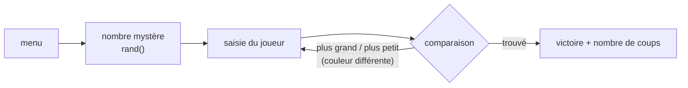

<div align="center">

# 📚 Apprentissage du C++

**Mes premiers programmes en C++ (septembre – décembre 2020), appris seul à partir de cours en ligne.**


</div>

---

## ✨ Les programmes

| Programme | Principe | Notions travaillées |
|---|---|---|
| 🎯 **Juste Prix** (`juste_prix.cpp`) | deviner un nombre aléatoire avec des indices, menu et couleurs dans la console | boucles, conditions, `rand()`, API console Windows |
| 🎯 `juste_prix_v1.cpp` | première version du même jeu | — |
| ⭕ **Morpion** (`morpion.cpp`) | début d'un morpion à deux joueurs | entrées / sorties, tableaux |
| ➕ **Calculette** (`calculette.cpp`) | addition de deux nombres saisis | variables, `cin` / `cout` |

---

## 🚀 Compiler et lancer

```bash
# Windows (MinGW) — le Juste Prix utilise l'API console de Windows pour les couleurs
g++ juste_prix.cpp -o juste_prix.exe
juste_prix.exe

# Windows, macOS ou Linux
g++ calculette.cpp -o calculette && ./calculette
```

---

## ⚙️ Comment ça marche — Juste Prix



---

## 🗂️ Organisation des fichiers

```
Cours-autodidacte-Cpp-/
├── juste_prix.cpp      Juste Prix complet (console Windows en couleurs)
├── juste_prix_v1.cpp   première version
├── morpion.cpp         morpion (début)
└── calculette.cpp      calculatrice minimale
```

---

## 💻 Compatibilité

| | |
|---|---|
| **Compilateur** | g++ / MinGW, ou Visual Studio |
| **Système** | Windows pour les Juste Prix (`windows.h`) ; les autres partout |

---

## 📜 Licence

MIT — voir [LICENSE](LICENSE).

---

<div align="center"><sub>C++ · premiers pas · 2020</sub></div>
